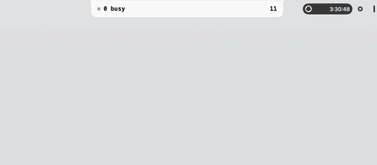
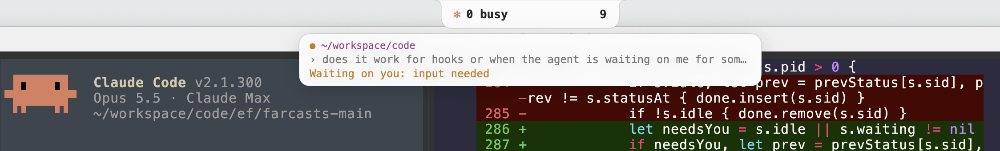

# AgentBar



An island at the top center of the screen, around the notch, in the system light or dark theme. It lists every live Claude Code
session and the codex runs each session dispatched.

- Pill: busy sessions on the left of the notch, total sessions and codex runs on the right.
- Hover the island to open it. Move the pointer off to close it.
- Rows are sorted by your last message, newest first. Each row shows the first 90 characters, the folder and the message age.
- Sessions with no typed message are hidden. The theme follows the system light or dark setting.
- Rest the pointer on a row to grow it: it shows your full message, its codex runs and the last reply of each run.
- Drag the handle at the bottom to show more or fewer rows (remembered). Double-click it to go back to five rows.
- Right-click a row to hide that session, or a codex run to hide that run. Hidden ones leave the list and the counts.
  A link at the bottom shows them again. Hidden entries are forgotten when their session or run ends.
- Click a row to focus that session's kitty window.
- When a session's turn ends, a card hangs under the closed island: one line of your message, one line of Claude's
  reply. Click it to jump to that kitty window; right-click to dismiss. It also clears if the session goes busy again.
  In the open list those sessions show a green dot.
- A session waiting on you gets the same card with an orange dot and what it needs. That is anything Claude Code
  reports as `status: waiting`: tool permission prompts (including ones a hook raises with an `ask` decision),
  questions from Claude, MCP input requests, sandbox requests and other dialogs. A hook that is only running counts as busy.

  

- Codex runs are hidden until the row grows. The row shows a gear count when it has runs.
- Codex rows show run time and the age of the last rollout write. After 12 minutes with no write the
  row turns orange (the RUNBOOK_CODEX stall rule).

Sources: `~/.claude/sessions/*.json`, `~/.claude/projects/*/<session>.jsonl`, `ps`, `~/.codex/run-owners/`,
and the codex rollout found with `lsof`.

```sh
./build.sh          # build AgentBar.app
./build.sh test     # parser self-check
open AgentBar.app
AgentBar.app/Contents/MacOS/AgentBar --dump   # print the scan as text
```

Focus works through the session tty: kitty has `allow_remote_control yes` but no `listen_on` socket.
