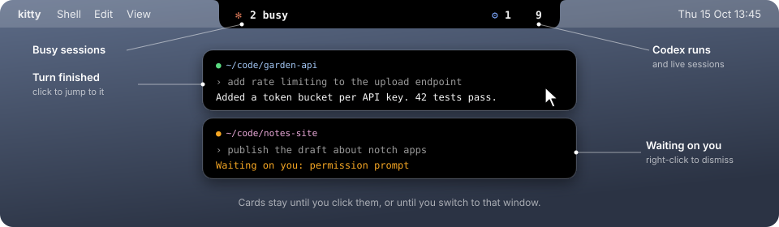

<div align="center">



# AgentBar

**Every Claude Code session you have open, in the notch. Finished ones come to you.**


</div>

AgentBar is an island at the top center of the screen, wrapped around the notch. It lists every live Claude Code
session and the Codex runs each one dispatched. When a session finishes or stops to ask you something, a card drops
under the notch until you deal with it. It follows the system light or dark theme.


## 🏝️ The island

| Where | What it does |
| --- | --- |
| ✻ **Left ear** | How many sessions are busy right now. |
| ⚙️ **Right ear** | Codex runs, then the total number of live sessions. |
| 🖱️ **Hover** | Opens the list. Move the pointer off and it closes. |
| 📋 **Rows** | Newest message first: the folder in its project color, the first 90 characters, and the message age. |
| 🔍 **Rest on a row** | The row grows to show your full message and its Codex runs, each with its last reply. |
| 👆 **Click a row** | Jumps to that session's kitty window. |
| 🙈 **Right-click** | Hides a session or a Codex run. A link at the bottom brings hidden ones back. |
| ↕️ **Drag the handle** | Shows more or fewer rows, and remembers it. Double-click for five rows again. |

Sessions where you have not typed anything yet stay out of the list.

## 🔔 Cards

When something needs you, a card hangs under the closed island: one line of your message, one line of the answer.

| | Card | What it shows |
| --- | --- | --- |
| 🟢 | **Turn finished** | Claude's last reply. |
| 🟠 | **Waiting on you** | What it needs: a tool permission prompt (including one a hook raises with an `ask` decision), a question from Claude, an MCP input request, a sandbox request or another dialog. |

- 👆 Click a card to jump to that kitty window. Right-click it to dismiss.
- 🔁 A card clears when its session goes busy again.
- 👀 The session you are already looking at gets no card, and a card clears when you switch to its window. This needs
  kitty's socket (see [Setup](#-setup)). Without it, every finished turn gets a card.
- 🟢 In the open list, sessions with a card show a dot of the same color.
- ⏳ A hook that is still running counts as busy, so it gets no card.


## ⚙️ Codex runs

- Each session's Codex runs stay hidden until its row grows. Until then the row shows a gear with the count.
- A run shows how long it has been running and when it last wrote to its rollout.
- 🟧 After 12 minutes with no write the run turns orange: it has probably stalled.

## 🛠️ Build and run

```sh
./build.sh          # build AgentBar.app
./build.sh test     # build, then run the parser self-check
open AgentBar.app
AgentBar.app/Contents/MacOS/AgentBar --dump   # print one scan as text
```

## 🐱 Setup

In `kitty.conf`:

```conf
allow_remote_control yes      # clicking a row or a card focuses its window
listen_on unix:/tmp/kitty     # lets AgentBar see which window you are in (restart kitty after adding)
```

Clicking works through the session's own tty, so it needs only `allow_remote_control`. Knowing which window you are
in needs the socket, because the tty route cannot read kitty's reply.

## 📂 Where the data comes from

| Source | Used for |
| --- | --- |
| `~/.claude/sessions/*.json` | Live sessions, busy, idle or waiting, and what they wait for |
| `~/.claude/projects/*/<session>.jsonl` | Your last message and Claude's last reply |
| `ps` | Codex processes and which session started them |
| `~/.codex/run-owners/` | Run names and owners recorded by the Codex dispatcher |
| `lsof` | Each Codex run's rollout file |
| `kitten @ ls` | The kitty window you are in |

## 🤝 Goes well with

**[kitty, but like iTerm](https://github.com/atharva-2001/kitty-but-like-iterm)**: the iTerm2 shortcuts, tabs and
splits in kitty, which is where AgentBar's sessions live.
